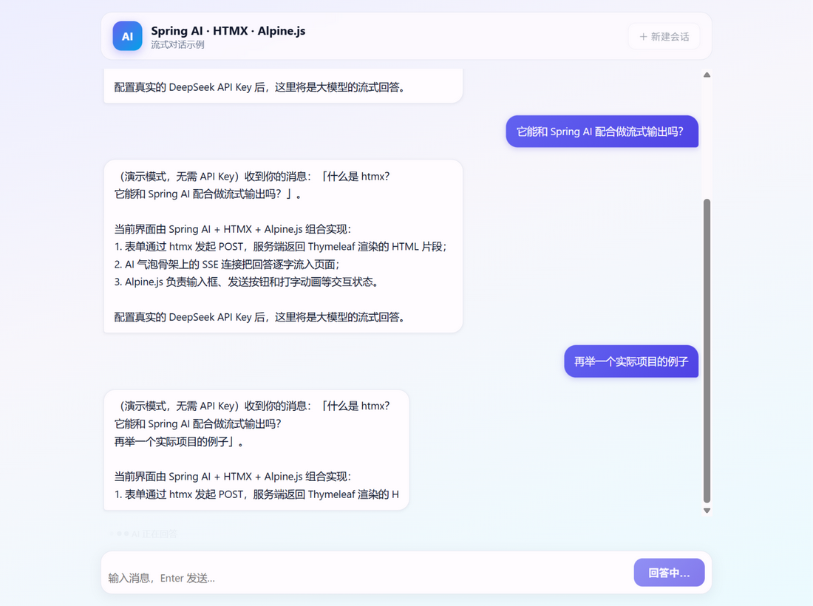

# spring-ai-htmx-chat

> English | [中文](README.zh-CN.md)

A streaming AI chat UI built with Spring AI + HTMX 4 + Alpine.js + Thymeleaf: no frontend framework,
no npm build — server-rendered HTML fragments plus SSE streaming give you a ChatGPT-style typing effect.

Stack versions: **htmx 4.0.0** (the fetch rewrite, where SSE streaming swaps are back at the core) and
**Alpine.js 3.17.2**.

## Demo

While streaming: the AI answer flows into the chat bubble token by token, the status bar shows a typing
animation, and the send button is locked to prevent duplicate submissions.



## Features

- **Streaming**: the AI answer streams token by token over SSE (`text/event-stream`) with a typing animation
- **Multi-turn chat**: server-side `MessageWindowChatMemory` keeps context per conversation id (last 20 messages)
- **New conversation**: one click switches to a new conversation id and clears both server memory and the page
- **No frontend build**: htmx/Alpine.js from CDN, styles in a single hand-written CSS file

## Run

### Option 1: demo mode (no API key)

A built-in local fake model streams a fixed reply token by token, to try the full interaction flow:

```bash
./gradlew :spring-ai-htmx-chat:bootRun --args='--spring.profiles.active=demo'
```

### Option 2: real LLM (DeepSeek)

1. Set `spring.ai.deepseek.api-key` in `src/main/resources/application.properties`
   (or export the environment variable `DEEPSEEK_API_KEY`);
2. Start:

```bash
./gradlew :spring-ai-htmx-chat:bootRun
```

Then open <http://localhost:8080> in a browser.

## How it works

htmx 4 is rewritten on fetch, and its bundled `sse` extension can consume a **plain request that returns a
`text/event-stream` response** — every SSE message is treated as a partial swap. So the whole chat needs a
single endpoint:

```
Browser                                  Server
  │ POST /chat (htmx form)                │
  │      Accept: text/event-stream        │
  │──────────────────────────────────────▶│ calls the LLM streaming API
  │◀ SSE message 1: chat skeleton          │  user bubble + AI bubble (typing animation, unique id)
  │◀ SSE message 2: <hx-partial …> text    │  one message per token, accumulated
  │◀ SSE message 3: <hx-partial …> text    │
  │◀ …stream ends (connection closed)      │
```

- **htmx**: form `hx-post` + `hx-swap="beforeend"`; the 1st SSE message appends the "user bubble + AI
  bubble skeleton" to the message list; each following message is an
  `<hx-partial hx-target="#ans-xxx" hx-swap="innerHTML">` fragment that replaces the AI bubble text — the
  typing animation naturally disappears when the first token arrives
- **Request lifecycle**: htmx 4 defaults to `sse.releaseOn:end`, so `htmx:finally:request` (note the v4
  colon-style event names) only fires when the SSE stream ends, naturally preventing duplicate submissions
  during streaming
- **Alpine.js**: listens to `@htmx:before:request` (lock input, clear the box), `@htmx:finally:request`
  (unlock when the stream ends) and `@htmx:sse:after:message` (scroll to bottom after each message),
  managing button/empty-state UI
- **Spring AI**: `ChatClient` + `MessageChatMemoryAdvisor` provide memory-aware streaming chat; the
  conversation id is passed per request via the `ChatMemory.CONVERSATION_ID` parameter
- **XSS protection**: user messages rendered with `th:text`; model tokens escaped manually before output

## Key files

| File | Description |
| --- | --- |
| `ChatController.java` | POST /chat returns the SSE stream (skeleton message + per-token hx-partial messages); DELETE clears the conversation |
| `ChatConfig.java` | ChatClient / ChatMemory wiring; fake model for demo mode |
| `templates/index.html` | Chat page, htmx 4 + Alpine.js interaction |
| `templates/fragments/chat.html` | Opening fragment of one turn (user bubble + AI bubble skeleton) |
| `static/css/chat.css` | UI styles |

## Test

Tests replace `DeepSeekChatModel` with `@MockitoBean`, no real API key needed:

```bash
./gradlew :spring-ai-htmx-chat:test
```

## Blog

[HTMX实现AI流式聊天界面](https://springcamp.cn/spring-ai-htmx-chat/)（Chinese）
