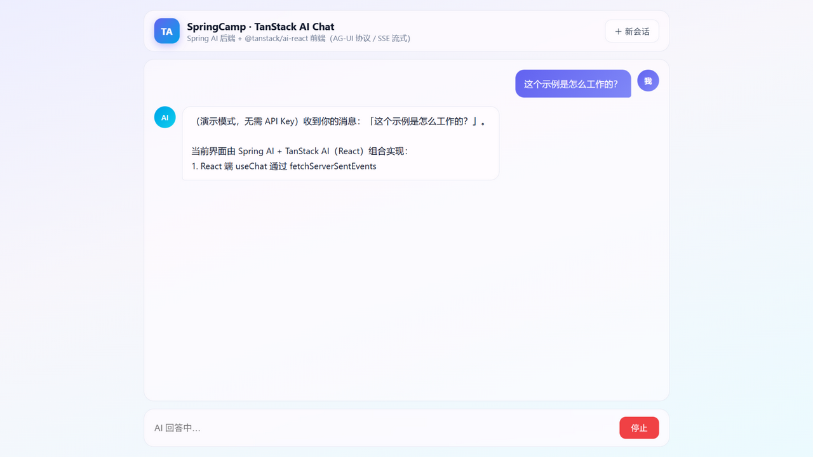

# spring-ai-tanstack-chat

> English | [中文说明](README.zh-CN.md)

A streaming AI chat UI built with Spring AI + TanStack AI (React): the same experience as
[spring-ai-htmx-chat](../spring-ai-htmx-chat), but the frontend is TanStack AI — the `useChat` hook speaking
the AG-UI protocol. No hand-built HTML fragments; React state drives the rendering.

Stack versions: **@tanstack/ai-react 1.0** (the React binding of TanStack AI), **React 19**, **Vite 8**.

## Demo

While streaming: the AI answer flows into the chat bubble token by token, the input is locked to
"AI 回答中…", and the send button switches to "停止" (stop).



## Features

- **Streaming**: the backend wraps each token into an AG-UI event (`TEXT_MESSAGE_CONTENT`) pushed over SSE;
  `useChat` incrementally updates the message parts
- **Multi-turn chat**: AG-UI POSTs the full conversation history every turn, so the server is stateless and
  needs no ChatMemory (in contrast with the server-side memory of the htmx version)
- **Interrupt**: stop the generation at any time while streaming (client-side abort)
- **New conversation**: one click switches to a new threadId and clears the message list

## Run

Backend (Spring AI, port 8080):

### Option 1: demo mode (no API key)

A built-in local fake model streams a fixed reply token by token, to try the full interaction flow:

```bash
./gradlew :spring-ai-tanstack-chat:bootRun --args='--spring.profiles.active=demo'
```

### Option 2: real LLM (DeepSeek)

1. Set `spring.ai.deepseek.api-key` in `src/main/resources/application.properties`
   (or export the environment variable `DEEPSEEK_API_KEY`);
2. Start:

```bash
./gradlew :spring-ai-tanstack-chat:bootRun
```

Frontend (Vite dev server, port 5173, `/api` proxied to 8080):

```bash
cd spring-ai-tanstack-chat/frontend
npm install
npm run dev
```

Then open <http://localhost:5173> in a browser.

## How it works

The TanStack AI client (`useChat`) talks to the backend over the **AG-UI protocol**
(TanStack AI's standard wire protocol):

```
Browser (React useChat)                       Spring backend
  │ POST /api/chat (fetchServerSentEvents)    │
  │    body: {threadId, runId, messages[]}    │ AG-UI request: full chat history
  │──────────────────────────────────────────▶│ Spring AI calls the LLM streaming API
  │◀ data:{"type":"RUN_STARTED",...}          │
  │◀ data:{"type":"TEXT_MESSAGE_START",...}   │
  │◀ data:{"type":"TEXT_MESSAGE_CONTENT",     │ one SSE event per token
  │        "delta":"..."}                     │
  │◀ data:{"type":"TEXT_MESSAGE_END",...}     │
  │◀ data:{"type":"RUN_FINISHED",...}         │
```

- **useChat**: `useChat({ connection: fetchServerSentEvents('/api/chat'), threadId })` returns
  `messages / sendMessage / isLoading / stop`; streamed events are appended to the last assistant
  message's parts automatically
- **One backend endpoint is all you need**: forward the `RunAgentInput` messages to `ChatClient.stream()`
  and map the token flux into AG-UI events (see `ChatController.AgUiEvent`); the client carries the
  history, the server stays stateless
- **Event format**: each SSE message is just `data:{JSON}` with a `type` discriminator; unparsable chunks
  only warn on the client, never break the stream
- **New conversation**: `useChat` keeps one client per threadId — switch the threadId to start fresh

## Key files

| File | Description |
| --- | --- |
| `ChatController.java` | POST /api/chat: AG-UI request → Spring AI streaming → AG-UI event stream |
| `ChatConfig.java` | ChatClient wiring; fake model for demo mode |
| `frontend/src/App.tsx` | Chat UI: useChat + bubbles + send/stop/new-conversation interaction |
| `frontend/vite.config.ts` | dev-time /api proxy to the Spring backend |

## Test

Backend tests replace `DeepSeekChatModel` with `@MockitoBean`, no real API key needed
(event ordering, multi-turn history forwarding, and the error path are covered):

```bash
./gradlew :spring-ai-tanstack-chat:test
```

Frontend typecheck and build:

```bash
cd frontend && npm run build
```
