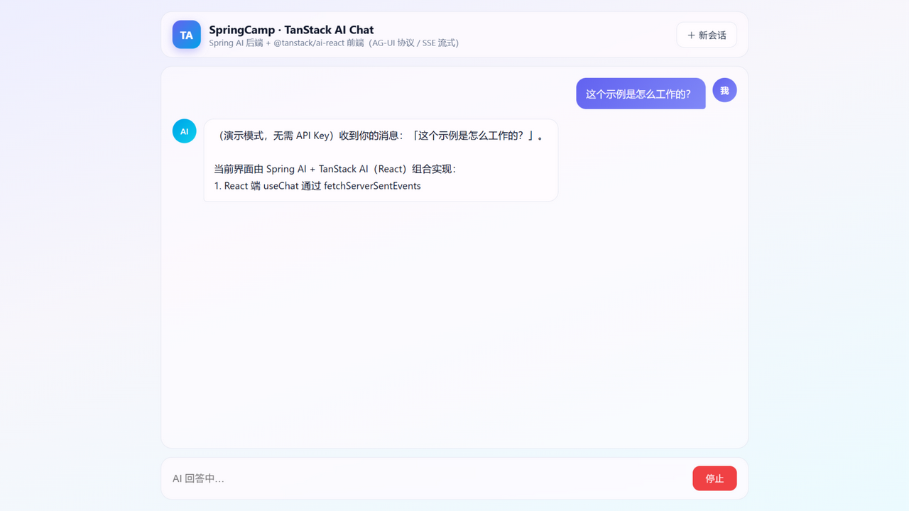

# spring-ai-tanstack-chat

> [English](README.md) | 中文说明

Spring AI + TanStack AI（React）实现的流式 AI 聊天界面：与 [spring-ai-htmx-chat](../spring-ai-htmx-chat) 同样的效果，
前端技术栈换成 TanStack AI——`useChat` 钩子 + AG-UI 协议，不写一行 HTML 片段拼接，React 状态驱动渲染。

技术栈版本：**@tanstack/ai-react 1.0**（TanStack AI 的 React 框架绑定）、**React 19**、**Vite 8**。

## 界面演示

流式输出中：AI 回答逐字流入气泡，输入框锁定为「AI 回答中…」，发送按钮切换为「停止」。



## 功能

- **流式输出**：后端把每个 token 包装成 AG-UI 事件（`TEXT_MESSAGE_CONTENT`）经 SSE 推送，`useChat` 增量更新消息 parts
- **多轮对话**：AG-UI 协议每轮 POST 完整对话历史，服务端无状态、无需 ChatMemory（与 htmx 版的服务端记忆形成对比）
- **中断生成**：流式过程中可随时「停止」（客户端 abort 请求）
- **新会话**：一键换 threadId，客户端消息列表清空

## 运行

后端（Spring AI，默认 8080 端口）：

### 方式一：demo 模式（无需 API Key）

内置一个本地假模型，把一段固定回复逐字吐出，用于体验完整交互流程：

```bash
./gradlew :spring-ai-tanstack-chat:bootRun --args='--spring.profiles.active=demo'
```

### 方式二：接入真实大模型（DeepSeek）

1. 修改 `src/main/resources/application.properties` 中的 `spring.ai.deepseek.api-key`
   （或设置环境变量 `DEEPSEEK_API_KEY`）；
2. 启动：

```bash
./gradlew :spring-ai-tanstack-chat:bootRun
```

前端（Vite dev server，默认 5173 端口，`/api` 自动代理到 8080）：

```bash
cd spring-ai-tanstack-chat/frontend
npm install
npm run dev
```

浏览器打开 <http://localhost:5173>。

## 实现要点

TanStack AI 客户端（`useChat`）与后端之间走 **AG-UI 协议**（TanStack AI 的标准线协议）：

```
浏览器 (React useChat)                        Spring 后端
  │ POST /api/chat (fetchServerSentEvents)     │
  │    body: {threadId, runId, messages[]}     │ AG-UI 请求体：完整对话历史
  │───────────────────────────────────────────▶│ Spring AI 调用大模型流式接口
  │◀ data:{"type":"RUN_STARTED",...}           │
  │◀ data:{"type":"TEXT_MESSAGE_START",...}    │
  │◀ data:{"type":"TEXT_MESSAGE_CONTENT",      │ 每个 token 一条 SSE 事件
  │        "delta":"..."}                      │
  │◀ data:{"type":"TEXT_MESSAGE_END",...}      │
  │◀ data:{"type":"RUN_FINISHED",...}          │
```

- **useChat**：`useChat({ connection: fetchServerSentEvents('/api/chat'), threadId })` 返回
  `messages / sendMessage / isLoading / stop`，流式事件自动拼进最后一条 assistant 消息的 parts
- **后端只需实现一个接口**：把 `RunAgentInput` 里的消息转给 `ChatClient.stream()`，
  再把 token 流映射成 AG-UI 事件（见 `ChatController.AgUiEvent`）；对话历史由客户端带回，服务端无状态
- **事件格式**：每条 SSE 消息就是 `data:{JSON}`，chunk 带 `type` 判别字段，客户端解析失败仅告警不中断
- **新会话**：`useChat` 按 threadId 建立独立会话，换 threadId 即清空重来

## 关键文件

| 文件 | 说明 |
| --- | --- |
| `ChatController.java` | POST /api/chat：AG-UI 请求 → Spring AI 流式调用 → AG-UI 事件流 |
| `ChatConfig.java` | ChatClient 装配，demo 模式假模型 |
| `frontend/src/App.tsx` | 聊天界面：useChat + 气泡渲染 + 发送/停止/新会话交互 |
| `frontend/vite.config.ts` | dev 阶段 /api 代理到 Spring 后端 |

## 测试

后端测试用 `@MockitoBean` 替换 `DeepSeekChatModel`，不依赖真实 API Key（覆盖事件顺序、多轮历史转发、异常路径）：

```bash
./gradlew :spring-ai-tanstack-chat:test
```

前端类型检查与构建：

```bash
cd frontend && npm run build
```
